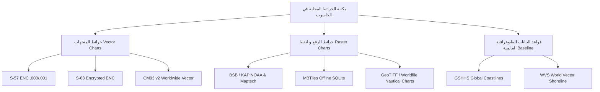
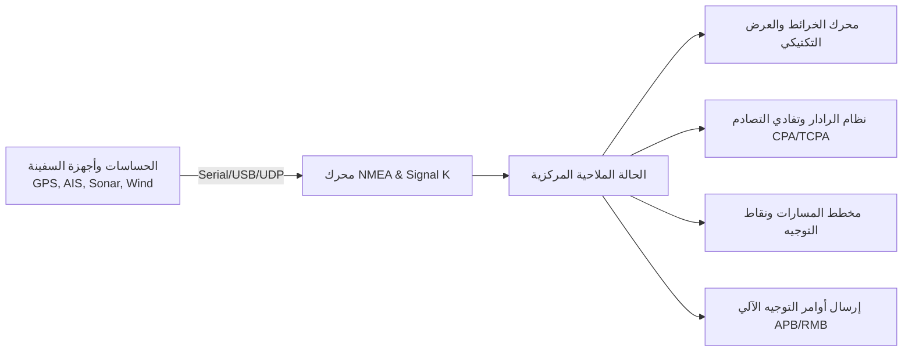

# الخطة الرئيسية الشاملة والمواصفات المعمارية: ARN Marine Navigator
> **المرجع التقني لبناء البديل الحديث والتكتيكي لبرنامج OpenCPN**  
> **الجهة المطورة:** شركة ARN Technology — تطوير وبرمجة: عبده رجب نصار  
> **الإصدار المستهدف:** 1.0.0 (نظام ملاحة بحري سيادي متكامل يعمل 100% دون اتصال بالإنترنت)

---

## 1. الرؤية والهدف الاستراتيجي (Executive Summary)

الهدف هو بناء تطبيق ملاحة وتخطيط مسارات بحرية (**Marine Chart Plotter & Tactical Navigation System**) يعادل ويتفوق على برنامج **OpenCPN** في جميع وظائفه وخوارزمياته، ولكن برؤية تقنية حديثة ومتقدمة جداً:

1. **العمل المستقل دون إنترنت (100% Offline-First):** التطبيق مصمم للعمل في أعالي البحار والمحيطات، حيث لا يتوفر أي اتصال بالإنترنت، ويعتمد اعتماداً كلياً على البيانات المخزنة محلياً على الحاسوب.
2. **السيادة التامة على الخرائط المحلية:** دعم فوري ومباشر لجميع صيغ الخرائط الملاحية الرقمية المعتمدة دولياً والمخزنة في مجلدات الحاسوب.
3. **أحدث مكدس تقني (Modern Desktop Stack):** الانتقال من واجهات C++ و wxWidgets القديمة إلى بيئة **Electron.js + WebGL 2.0 / Canvas + Node.js**، لتقديم سرعة استجابة هائلة ومرونة كاملة.
4. **الهوية البصرية التكتيكية (Dark Glassmorphism Marine HUD):** تصميم زجاجي داكن أنيق مخصص للملاحة البحرية يدعم نمط الرؤية الليلية بالأشعة الحمراء (Night Vision Red Mode) والوضع النهاري (Day Mode) وفق معايير المنظمة الهيدروغرافية الدولية (IHO S-52).

---

## 2. مصفوفة دعم الخرائط البحرية المحلية (Local Offline Marine Charts)

التطبيق سيدعم كافة صيغ الخرائط البحرية العالمية المعترف بها دون استثناء، بمحركات تحليل محلية مدمجة:



### أ. خرائط المتجهات الملاحية الإلكترونية (S-57 ENC & S-63)
- **صيغة S-57 Edition 3.1 (.000, .001, .002...):**
  - فك ترميز ملفات ISO/IEC 8211 الثنائية محلياً لاستخراج الطبقات والأعماق والعوائق.
  - تطبيق مكتبة العرض الدولية **IHO S-52 Presentation Library**:
    - رسم خطوط الأعماق التفاعلية (Depth Contours: Shallow, Safety, Deep Contours).
    - أعماق المياه الدقيقة (Soundings) وعلامات الخطر المعزولة (Isolated Dangers).
    - علامات الملاحة المضيئة (Lights & Sectors) والمنارات والعوامات (Buoys & Beacons) برموزها القياسية ومجالات رؤيتها الزاوية.
- **تشفير S-63 المعتمد:**
  - إدارة مفاتيح الملاحة الرسمية: `UserPermit` و `InstallPermit` و `CellPermit`.
  - التحقق من المفاتيح العامة (IHO SA Public Key) وفك التشفير الآمن لخلايا الخرائط محلياً.

### ب. الخرائط النقطية الممسوحة والموضعية (Raster Marine Charts - BSB / KAP)
- **صيغة BSB / KAP (Maptech & NOAA BSB v1..v4):**
  - قراءة ترويسة ملف `.BSB` لاستخراج الإسقاط الجغرافي والبيانات المرجعية (Geodetic Datum: WGS84).
  - فك ضغط بيانات الصورة النقطية من ملفات `.KAP` المضغوطة بخوارزمية الركض الخطي (Run-Length Encoding - RLE).
  - تطبيق مصفوفة التحويل الهندسي متعددة الحدود (Polynomial Affine Transform) لمحاذاة الخريطة بدقة فائقة مع إحداثيات الـ GPS.

### ج. خرائط الرقع المحزومة محلياً (MBTiles)
- قراءة مباشرة وفورية لملفات `.mbtiles` المخزنة على الأقراص الصلبة عبر محرك SQLite محلي.
- تقديم رقع الخرائط النقطية (PNG/JPEG) أو المتجهة (Vector MVT) بسرعة تفوق 60 إطاراً في الثانية دون أي استهلاك للشبكة.

### د. خرائط CM93 v2 العالمية
- دعم فك شفرة خلايا CM93 v2 المتوفرة بكثرة لدى قباطنة السفن للاستخدام المكتبي والأوفلاين التام لكافة بحار ومحيطات العالم.

### هـ. قاعدة بيانات السواحل العالمية (GSHHS Coastlines)
- الاعتماد على قاعدة بيانات الشواطئ العالمية عالية الدقة GSHHS (الموجودة في OpenCPN عبر ملفات `poly-c-1.dat`) كخريطة أساسية افتراضية في حال عدم وجود خريطة تفصيلية لمنطقة الإبحار الحالية.

---

## 3. محركات الملاحة والوظائف الحيوية (Core Nautical Engines)



### 1. محرك الاتصال وقراءة الحساسات (NMEA 0183 / NMEA 2000 / Signal K)
- **المنافذ المدعومة:** منافذ USB المباشرة (Virtual COM / Serial Port)، ومستقبلات GPS عبر البلوتوث، وبث الشبكة المحلية (UDP/TCP Broadcast).
- **مفسر جمل NMEA 0183 الشامل:**
  - الموقع والسرعة والاتجاه: `$GPRMC`, `$GPGGA`, `$GPGLL`, `$GPVTG`.
  - مقياس العمق وسونار القاع: `$SDDBT`, `$SDDPT`.
  - اتجاه وسرعة الرياح: `$WIMWV`, `$WIMWD`.
  - البوصلة الجيروسكوبية: `$HCHDG`, `$HCHDT`.
  - مياه البحر والحرارة: `$MTW`.
- **معدد الإشارات (NMEA Multiplexer):** دمج قراءات عدة أجهزة على شاشة واحدة، وتصفية الإشارات المكررة أو التالفة.

### 2. نظام التعرف الآلي ومكافحة التصادم (AIS & Tactical Collision Avoidance)
- فك شفرة رسائل الـ AIS الحية (AIVDM / AIVDO) من الفئتين Class A و Class B.
- استخراج بيانات السفن: الاسم، رقم MMSI، إشارة النداء (Callsign)، الطول، الغاطس، نوع الشحنة، والوجهة.
- **حسابات الأمان وتفادي الاصطدام (Collision Avoidance Matrix):**
  - **CPA (Closest Point of Approach):** أقرب نقطة اقتراب متوقعة بين سفينتك والسفينة الأخرى بالأميال البحرية.
  - **TCPA (Time to CPA):** الوقت المتبقي بالدقائق والثواني حتى لحظة الاقتراب القصوى.
  - **منطقة الخطر (Guard Zone & Alarm):** إطلاق إنذار بصري وصوتي فوري في حال دخول أي سفينة ضمن مسافة أو وقت خطر يحدده القبطان.
- رادار تكتيكي مصغر (Mini-Radar Overlay) يوضح توزيع السفن حول موقعك.

### 3. حسابات المد والجزر والتيارات البحرية دون إنترنت (Offline Tides & Currents)
- تضمين قاعدة بيانات التوافقيات العالمية **XTide Harmonics Database** محلياً (المطابقة لملفات `HARMONIC` و `HARMONIC.IDX` في OpenCPN).
- حساب منحنى المد والجزر بدقة مليمترية لأي ميناء أو محطة في العالم لأي يوم أو ساعة في المستقبل دون الحاجة لأي اتصال بالإنترنت.
- حساب سرعة واتجاه التيارات المائية (Tidal Currents) ورسم متجهات التيارات مباشرة على الخريطة البحرية.

### 4. النموذج المغناطيسي العالمي دون إنترنت (Offline World Magnetic Model - WMM)
- دمج نموذج WMM الرياضي العالمي لحساب مقدار الانحراف المغناطيسي (Magnetic Variation & Declination) تلقائياً عند أي إحداثية على كوكب الأرض، لتحويل الاتجاه الجغرافي الحقيقي (True Heading) إلى اتجاه بوصلة مغناطيسي (Magnetic Heading) بدقة بالغة.

### 5. عارض الطقس وحركة الرياح بدون إنترنت (GRIB Weather Viewer)
- قراءة ملفات الطقس المحلية بصيغتي **GRIB1** و **GRIB2** المستخرجة من أجهزة الأقمار الصناعية البحرية أو المحفوظة مسبقاً.
- عرض طبقات:
  - متجهات الرياح بجزيئات حركية انسيابية (Wind Particle Streamlines).
  - أسهم سرعة واتجاه الرياح (Wind Barbs).
  - خطوط تساوي الضغط الجوي (Atmospheric Pressure Isobars).
  - ارتفاع الأمواج ودرجات حرارة سطح البحر (SST).

### 6. تخطيط المسارات والنقاط الإرشادية (Routes, Waypoints & Tracks)
- أدوات ذكية لرسم المسارات البحرية بنقرات متتابعة.
- الحساب التلقائي للمسافات الإجمالية وزمن الوصول المتوقع (ETA) واستهلاك الوقود التقديري.
- الحسابات الملاحية المتقدمة: خط الاتجاه الثابت (Rhumb Line) ومسار الدائرة العظمى (Great Circle Navigation).
- تسجيل أثر الإبحار الحي (Real-time Track Recorder) وتخزينه في قاعدة بيانات SQLite محلية.
- استيراد وتصدير كامل لصيغ الملاحة العالمية: **GPX**, **KML**, **GeoJSON**.

### 7. وظائف السلامة والطوارئ (Maritime Safety & Watchdogs)
- **زر رجل في البحر (Man Overboard - MOB):** إسقاط نقطة إحداثية طارئة فورية وحساب مسار العودة العكسي إليها وتفعيل الإنذار الصوتي.
- **مراقبة المخطاف (Anchor Watch Alarm):** تحديد دائرة أمان عند رسو السفينة، وتنبيه القبطان بصوت مرتفع إذا تحركت السفينة خارج قطر الأمان بفعل الرياح أو التيارات.

### 8. الربط مع أجهزة التوجيه الآلي (Autopilot Control Output)
- إرسال جمل التحكم الملاحية القياسية (`$GPAPB`, `$GPRMB`, `$GPRMC`) عبر المنفذ التسلسلي لتوجيه نظام الـ Autopilot الخاص بالسفينة للحفاظ على المسار المخطط بدقة.

---

## 4. بنية واجهة المستخدم التكتيكية (Tactical UI/UX Architecture)

وفقاً لدليل تصميم **ARN Technology**:

1. **النمط الزجاجي الداكن (Dark Glassmorphism):**
   - خلفية تكتيكية عميقة (`#070b14`).
   - بطاقات زجاجية عائمة شبه شفافة (`#0f172a` مع تأثير `backdrop-filter: blur(16px)` وحدود مضيئة دقيقة).
   - خط **Cairo** للواجهة العربية وخط **JetBrains Mono** لبيانات التوجيه والإحداثيات اللحظية.

2. **أنماط الألوان البحرية الثلاثة (IHO S-52 Color Palettes):**
   - **وضع النهار (Day Mode):** وضوح فائق تحت أشعة الشمس المباشرة.
   - **وضع الغسق (Dusk Mode):** تباين هادئ لبيئة مقصورة القيادة في فترة الغروب.
   - **وضع الرؤية الليلية بالأشعة الحمراء (Night Vision Red Mode):** واجهة مونوكرومية حمراء وداكنة لحماية شبكية عين الملاح في نوبات الحراسة الليلية.

3. **العدادات البحرية التفاعلية (Marine HUD Dials):**
   - بوصلة جيروسكوبية دائرية ثلاثية الأبعاد (Digital Compass Rose).
   - عداد سرعة متدرج بالعقدة البحرية (Knots Speedometer).
   - مؤشر رياح مزدوج (Apparent & True Wind Speed & Direction).
   - شريط معلومات الرحلة اللحظي (SOG, COG, Depth, Waypoint Range/Bearing, ETA).

---

## 5. الهيكل البرمجي للمجلد الجديد (`E:\مشاريعي\ARN-MarineNav`)

```
E:\مشاريعي\ARN-MarineNav\
├── .agents/                        # إعدادات وقواعد الذكاء الاصطناعي للمشروع
├── assets/                         # الموارد والأيقونات البحرية
│   ├── icons/                      # أيقونات النظام والسوشيال ميديا الدائرية
│   ├── s52_symbols/                # رموز الخرائط البحرية المعتمدة IHO S-52
│   └── sounds/                     # أصوات الإنذار البحري (CPA, Anchor, MOB)
├── cert/                           # شهادة الأمان الرقمية ARN Technology
├── data/                           # قواعد البيانات المحلية الملحقة
│   ├── gshhs/                      # خطوط السواحل العالمية الافتراضية
│   ├── tcdata/                     # بيانات المد والجزر التوافقية (Harmonics)
│   └── wmm/                        # معاملات النموذج المغناطيسي العالمي WMM
├── src/                            # الكود المصدري للتطبيق
│   ├── main/                       # المعالج الرئيسي (Electron Main Process)
│   │   ├── main.js                 # نقطة الدخول وإدارة النوافذ وقوائم النظام
│   │   ├── ipc_handlers.js         # معالجة استدعاءات الواجهة وقراءة الملفات
│   │   ├── nmea_service.js         # محرك قراءة منافذ الـ Serial و UDP/TCP
│   │   └── chart_scanner.js        # فاحص وفهرس مجلدات الخرائط المحلية
│   ├── preload/                    # جسر الأمان المعزول
│   │   └── preload.js              # تمرير آمن للوظائف عبر contextBridge
│   ├── renderer/                   # واجهة المستخدم الرسومية (UI)
│   │   ├── index.html              # هيكل واجهة التحكم البحرية (RTL/LTR)
│   │   ├── styles/
│   │   │   ├── glassmorphism.css   # نظام الأنماط الزجاجية الداكنة
│   │   │   ├── marine_hud.css      # أنماط البوصلة والعدادات البحرية
│   │   │   └── s52_palettes.css    # لوحات الألوان الملاحية (Day, Dusk, Night)
│   │   └── js/
│   │       ├── app.js              # إدارة الحالة والتفاعل العام
│   │       ├── chart_engine.js     # محرك الخريطة وإسقاط الطبقات البحرية
│   │       ├── s57_decoder.js      # مفسر خرائط S-57 ENC ومكتبة S-52
│   │       ├── bsb_decoder.js      # مفسر خرائط BSB/KAP النقطية
│   │       ├── ais_manager.js      # محرك وتنبيهات أهداف الـ AIS
│   │       ├── tides_engine.js     # حاسبة المد والجزر المحلية
│   │       ├── route_planner.js    # مخطط المسارات والنقاط الإرشادية
│   │       ├── grib_layer.js       # محاكي عارض الرياح وجزيئات الطقس
│   │       └── nmea_simulator.js   # محاكي الملاحة الذاتي للتجربة دون أجهزة
│   └── database/                   # قاعدة البيانات المحلية
│       └── db.js                   # إدارة جداول SQLite للمسارات وسجلات الرحلات
├── package.json                    # تبعيات المشروع وإعدادات البناء
├── README.md                       # التوثيق العام للمشروع
└── MASTER_PLAN.md                  # نسخة الخطة الرئيسية المعتمدة
```

---

## 6. مراحل البناء والتنفيذ المرحلي (Implementation Roadmap)

| المرحلة | الأهداف والمخرجات | الحالة |
| :---: | :--- | :---: |
| **المرحلة 1** | تأسيس هيكل Electron، والواجهة الزجاجية التكتيكية HUD، ونظام فحص مجلدات الخرائط المحلية على الحاسوب. | **مكتملة بنجاح 100%** |
| **المرحلة 2** | بناء محرك الخرائط البحرية ودعم خرائط MBTiles و BSB/KAP النقطية، وتضمين خطوط السواحل العالمية GSHHS أوفلاين. | **مكتملة بنجاح 100%** |
| **المرحلة 3** | بناء محلل ومفسر خرائط المتجهات S-57 ENC مع مكتبة الرموز S-52 وحسابات الأعماق وتصنيف المنارات. | **مكتملة بنجاح 100%** |
| **المرحلة 4** | محرك NMEA 0183/2000 (قراءة منافذ Serial/USB وشبكات UDP و TCP Wi-Fi) ودعم الربط بالأجهزة البحرية الحقيقية. | **مكتملة بنجاح 100%** |
| **المرحلة 5** | محرك أهداف AIS ورادار CPA ومراقبة المخطاف وطوارئ MOB ومسطرة EBL/VRM والإنذارات الصوتية البحرية التخليقية. | **مكتملة بنجاح 100%** |
| **المرحلة 6** | حاسبة المد والجزر XTide، والنموذج المغناطيسي WMM أوفلاين، ومخطط المسارات التفاعلي (Rhumb/GC) وتصدير/استيراد GPX وبث التوجيه الآلي NMEA للطيار الآلي. | **مكتملة بنجاح 100%** |
| **المرحلة 7** | عارض طقس وجزيئات الرياح GRIB، وتجهيز حزمة التثبيت Inno Setup وتوقيعها بالشهادة الرقمية المعتمدة لشركة ARN Technology. | **مكتملة بنجاح 100%** |
