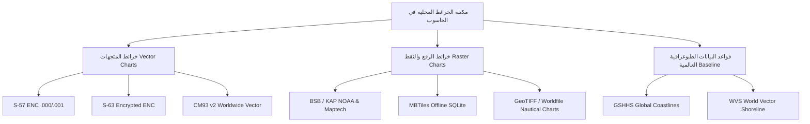
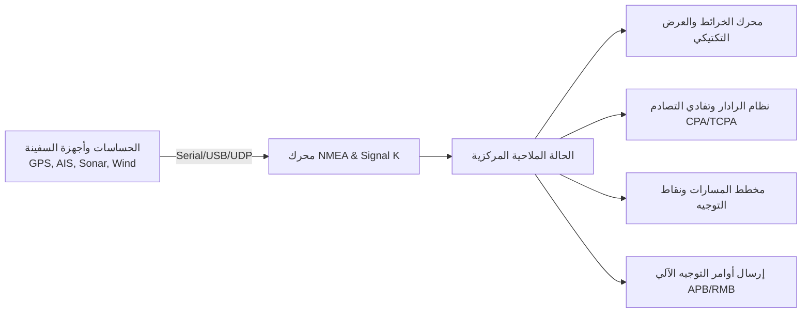

# الخطة الرئيسية الشاملة والمواصفات المعمارية: ARN Marine Navigator
> **المرجع التقني لبناء البديل الحديث والتكتيكي لبرنامج OpenCPN**  
> **الجهة المطورة:** شركة ARN Technology — تطوير وبرمجة: عبده رجب نصار  
> **الإصدار المستهدف:** 1.0.0 (نظام ملاحة بحري سيادي متكامل يعمل 100% دون اتصال بالإنترنت)

> ⚠️ **تنبيه مصداقية (تحديث 2026-10):** هذه الوثيقة وثيقة مواصفات *طموحة* تصف النظام المستهدف، وليست قائمة منجَزات. البنود التالية وردت في المتن كمواصفات لكنها **غير منفذة بعد** ولا يجوز الادعاء بها تسويقياً: **S-63 المشفّر، NMEA 2000/PGN، Signal K، KML، GeoJSON، CM93، GeoTIFF، GRIB2، اعتماد الهيئات (Type Approval)**. الحالة التنفيذية الفعلية موثقة في الجدول المحدّث بالقسم 6 وفي `README.md` و`PROJECT_ANALYSIS_REPORT.md`.

---

## 1. الرؤية والهدف الاستراتيجي (Executive Summary)

الهدف هو بناء تطبيق ملاحة وتخطيط مسارات بحرية (**Marine Chart Plotter & Tactical Navigation System**) يعادل ويتفوق على برنامج **OpenCPN** في جميع وظائفه وخوارزمياته، ولكن برؤية تقنية حديثة ومتقدمة جداً:

1. **العمل المستقل دون إنترنت (100% Offline-First):** التطبيق مصمم للعمل في أعالي البحار والمحيطات، حيث لا يتوفر أي اتصال بالإنترنت، ويعتمد اعتماداً كلياً على البيانات المخزنة محلياً على الحاسوب.
2. **السيادة التامة على الخرائط المحلية:** دعم فوري ومباشر لجميع صيغ الخرائط الملاحية الرقمية المعتمدة دولياً والمخزنة في مجلدات الحاسوب.
3. **أحدث مكدس تقني (Modern Desktop Stack):** الانتقال من واجهات C++ و wxWidgets القديمة إلى بيئة **Electron.js + WebGL 2.0 / Canvas + Node.js**، لتقديم سرعة استجابة هائلة ومرونة كاملة.
4. **الهوية البصرية التكتيكية (Dark Glassmorphism Marine HUD):** تصميم زجاجي داكن أنيق مخصص للملاحة البحرية يدعم نمط الرؤية الليلية بالأشعة الحمراء (Night Vision Red Mode) والوضع النهاري (Day Mode) وفق معايير المنظمة الهيدروغرافية الدولية (IHO S-52).

---

## 2. مصفوفة دعم الخرائط البحرية المحلية (Local Offline Marine Charts)

التطبيق سيدعم كافة صيغ الخرائط البحرية العالمية المعترف بها دون استثناء، بمحركات تحليل محلية مدمجة:



### أ. خرائط المتجهات الملاحية الإلكترونية (S-57 ENC & S-63)
- **صيغة S-57 Edition 3.1 (.000, .001, .002...):**
  - فك ترميز ملفات ISO/IEC 8211 الثنائية محلياً لاستخراج الطبقات والأعماق والعوائق.
  - تطبيق مكتبة العرض الدولية **IHO S-52 Presentation Library**:
    - رسم خطوط الأعماق التفاعلية (Depth Contours: Shallow, Safety, Deep Contours).
    - أعماق المياه الدقيقة (Soundings) وعلامات الخطر المعزولة (Isolated Dangers).
    - علامات الملاحة المضيئة (Lights & Sectors) والمنارات والعوامات (Buoys & Beacons) برموزها القياسية ومجالات رؤيتها الزاوية.
- **تشفير S-63 المعتمد — [غير منفذ بعد؛ مواصفة مستقبلية]:**
  - إدارة مفاتيح الملاحة الرسمية: `UserPermit` و `InstallPermit` و `CellPermit`.
  - التحقق من المفاتيح العامة (IHO SA Public Key) وفك التشفير الآمن لخلايا الخرائط محلياً.

### ب. الخرائط النقطية الممسوحة والموضعية (Raster Marine Charts - BSB / KAP)
- **صيغة BSB / KAP (Maptech & NOAA BSB v1..v4):**
  - قراءة ترويسة ملف `.BSB` لاستخراج الإسقاط الجغرافي والبيانات المرجعية (Geodetic Datum: WGS84).
  - فك ضغط بيانات الصورة النقطية من ملفات `.KAP` المضغوطة بخوارزمية الركض الخطي (Run-Length Encoding - RLE).
  - تطبيق مصفوفة التحويل الهندسي متعددة الحدود (Polynomial Affine Transform) لمحاذاة الخريطة بدقة فائقة مع إحداثيات الـ GPS.

### ج. خرائط الرقع المحزومة محلياً (MBTiles)
- قراءة مباشرة وفورية لملفات `.mbtiles` المخزنة على الأقراص الصلبة عبر محرك SQLite محلي.
- تقديم رقع الخرائط النقطية (PNG/JPEG) أو المتجهة (Vector MVT) بسرعة تفوق 60 إطاراً في الثانية دون أي استهلاك للشبكة.

### د. خرائط CM93 v2 العالمية
- دعم فك شفرة خلايا CM93 v2 المتوفرة بكثرة لدى قباطنة السفن للاستخدام المكتبي والأوفلاين التام لكافة بحار ومحيطات العالم.

### هـ. قاعدة بيانات السواحل العالمية (GSHHS Coastlines)
- الاعتماد على قاعدة بيانات الشواطئ العالمية عالية الدقة GSHHS (الموجودة في OpenCPN عبر ملفات `poly-c-1.dat`) كخريطة أساسية افتراضية في حال عدم وجود خريطة تفصيلية لمنطقة الإبحار الحالية.

---

## 3. محركات الملاحة والوظائف الحيوية (Core Nautical Engines)



### 1. محرك الاتصال وقراءة الحساسات (NMEA 0183 منفذ؛ NMEA 2000 / Signal K — [غير منفذين بعد])
- **المنافذ المدعومة:** منافذ USB المباشرة (Virtual COM / Serial Port)، ومستقبلات GPS عبر البلوتوث، وبث الشبكة المحلية (UDP/TCP Broadcast).
- **مفسر جمل NMEA 0183 الشامل:**
  - الموقع والسرعة والاتجاه: `$GPRMC`, `$GPGGA`, `$GPGLL`, `$GPVTG`.
  - مقياس العمق وسونار القاع: `$SDDBT`, `$SDDPT`.
  - اتجاه وسرعة الرياح: `$WIMWV`, `$WIMWD`.
  - البوصلة الجيروسكوبية: `$HCHDG`, `$HCHDT`.
  - مياه البحر والحرارة: `$MTW`.
- **معدد الإشارات (NMEA Multiplexer):** دمج قراءات عدة أجهزة على شاشة واحدة، وتصفية الإشارات المكررة أو التالفة.

### 2. نظام التعرف الآلي ومكافحة التصادم (AIS & Tactical Collision Avoidance)
- فك شفرة رسائل الـ AIS الحية (AIVDM / AIVDO) من الفئتين Class A و Class B.
- استخراج بيانات السفن: الاسم، رقم MMSI، إشارة النداء (Callsign)، الطول، الغاطس، نوع الشحنة، والوجهة.
- **حسابات الأمان وتفادي الاصطدام (Collision Avoidance Matrix):**
  - **CPA (Closest Point of Approach):** أقرب نقطة اقتراب متوقعة بين سفينتك والسفينة الأخرى بالأميال البحرية.
  - **TCPA (Time to CPA):** الوقت المتبقي بالدقائق والثواني حتى لحظة الاقتراب القصوى.
  - **منطقة الخطر (Guard Zone & Alarm):** إطلاق إنذار بصري وصوتي فوري في حال دخول أي سفينة ضمن مسافة أو وقت خطر يحدده القبطان.
- رادار تكتيكي مصغر (Mini-Radar Overlay) يوضح توزيع السفن حول موقعك.

### 3. حسابات المد والجزر والتيارات البحرية دون إنترنت (Offline Tides & Currents)
- تضمين قاعدة بيانات التوافقيات العالمية **XTide Harmonics Database** محلياً (المطابقة لملفات `HARMONIC` و `HARMONIC.IDX` في OpenCPN).
- حساب منحنى المد والجزر بدقة مليمترية لأي ميناء أو محطة في العالم لأي يوم أو ساعة في المستقبل دون الحاجة لأي اتصال بالإنترنت.
- حساب سرعة واتجاه التيارات المائية (Tidal Currents) ورسم متجهات التيارات مباشرة على الخريطة البحرية.

### 4. النموذج المغناطيسي العالمي دون إنترنت (Offline World Magnetic Model - WMM)
- دمج نموذج WMM الرياضي العالمي لحساب مقدار الانحراف المغناطيسي (Magnetic Variation & Declination) تلقائياً عند أي إحداثية على كوكب الأرض، لتحويل الاتجاه الجغرافي الحقيقي (True Heading) إلى اتجاه بوصلة مغناطيسي (Magnetic Heading) بدقة بالغة.

### 5. عارض الطقس وحركة الرياح بدون إنترنت (GRIB Weather Viewer)
- قراءة ملفات الطقس المحلية بصيغتي **GRIB1** و **GRIB2** المستخرجة من أجهزة الأقمار الصناعية البحرية أو المحفوظة مسبقاً.
- عرض طبقات:
  - متجهات الرياح بجزيئات حركية انسيابية (Wind Particle Streamlines).
  - أسهم سرعة واتجاه الرياح (Wind Barbs).
  - خطوط تساوي الضغط الجوي (Atmospheric Pressure Isobars).
  - ارتفاع الأمواج ودرجات حرارة سطح البحر (SST).

### 6. تخطيط المسارات والنقاط الإرشادية (Routes, Waypoints & Tracks)
- أدوات ذكية لرسم المسارات البحرية بنقرات متتابعة.
- الحساب التلقائي للمسافات الإجمالية وزمن الوصول المتوقع (ETA) واستهلاك الوقود التقديري.
- الحسابات الملاحية المتقدمة: خط الاتجاه الثابت (Rhumb Line) ومسار الدائرة العظمى (Great Circle Navigation).
- تسجيل أثر الإبحار الحي (Real-time Track Recorder) وتخزينه في قاعدة بيانات SQLite محلية.
- استيراد وتصدير **GPX** (منفذ: wpt/rte/trk). صيغتا **KML** و**GeoJSON** — [غير منفذتين بعد].

### 7. وظائف السلامة والطوارئ (Maritime Safety & Watchdogs)
- **زر رجل في البحر (Man Overboard - MOB):** إسقاط نقطة إحداثية طارئة فورية وحساب مسار العودة العكسي إليها وتفعيل الإنذار الصوتي.
- **مراقبة المخطاف (Anchor Watch Alarm):** تحديد دائرة أمان عند رسو السفينة، وتنبيه القبطان بصوت مرتفع إذا تحركت السفينة خارج قطر الأمان بفعل الرياح أو التيارات.

### 8. الربط مع أجهزة التوجيه الآلي (Autopilot Control Output)
- إرسال جمل التحكم الملاحية القياسية (`$GPAPB`, `$GPRMB`, `$GPRMC`) عبر المنفذ التسلسلي لتوجيه نظام الـ Autopilot الخاص بالسفينة للحفاظ على المسار المخطط بدقة.

---

## 4. بنية واجهة المستخدم التكتيكية (Tactical UI/UX Architecture)

وفقاً لدليل تصميم **ARN Technology**:

1. **النمط الزجاجي الداكن (Dark Glassmorphism):**
   - خلفية تكتيكية عميقة (`#070b14`).
   - بطاقات زجاجية عائمة شبه شفافة (`#0f172a` مع تأثير `backdrop-filter: blur(16px)` وحدود مضيئة دقيقة).
   - خط **Cairo** للواجهة العربية وخط **JetBrains Mono** لبيانات التوجيه والإحداثيات اللحظية.

2. **أنماط الألوان البحرية الثلاثة (IHO S-52 Color Palettes):**
   - **وضع النهار (Day Mode):** وضوح فائق تحت أشعة الشمس المباشرة.
   - **وضع الغسق (Dusk Mode):** تباين هادئ لبيئة مقصورة القيادة في فترة الغروب.
   - **وضع الرؤية الليلية بالأشعة الحمراء (Night Vision Red Mode):** واجهة مونوكرومية حمراء وداكنة لحماية شبكية عين الملاح في نوبات الحراسة الليلية.

3. **العدادات البحرية التفاعلية (Marine HUD Dials):**
   - بوصلة جيروسكوبية دائرية ثلاثية الأبعاد (Digital Compass Rose).
   - عداد سرعة متدرج بالعقدة البحرية (Knots Speedometer).
   - مؤشر رياح مزدوج (Apparent & True Wind Speed & Direction).
   - شريط معلومات الرحلة اللحظي (SOG, COG, Depth, Waypoint Range/Bearing, ETA).

---

## 5. الهيكل البرمجي الفعلي للمشروع

> تم التصحيح في 2026-10: الهيكل التالي هو الشجرة الحقيقية في المستودع. الهيكل السابق (`src/main/...`, `database/db.js`, `nmea_simulator.js`, مسار `E:\مشاريعي\...`) كان تصميماً مخططاً لم يُنفَّذ بتلك الأسماء. الشجرة الكاملة المحدثة مرجعها الأساسي `README.md`، والملخص:

```
ARN-CPN/
├── DesktopApp/                     # عملية Electron الرئيسية + كل الخدمات
│   ├── main.js                     # IPC ودورة حياة الموارد (أقفال، كاشات LRU، تنظيف الإغلاق)
│   ├── preload.js                  # جسر contextBridge المعزول
│   ├── nmea_service.js             # NMEA 0183/AIS (checksum إلزامي، multipart بسقف)
│   ├── autopilot_service.js        # إرسال تسلسلي حقيقي للطيار الآلي
│   ├── route_planner.js            # Rhumb/GC + GPX (wpt/rte/trk) + معرّفات UUID
│   ├── track_store.js              # أثر دائم في userData (سقف 20000 نقطة)
│   ├── s57_decoder.js              # S-57 ENC / ISO 8211 (واجهات async)
│   ├── bsb_decoder.js              # BSB/KAP RLE + PNG محلي
│   ├── mbtiles_reader.js           # MBTiles عبر sql.js (LRU)
│   ├── grib_decoder.js             # GRIB1 فقط (يرفض GRIB2 صراحة)
│   ├── gshhs_provider.js           # سواحل GSHHS بكاش محدود
│   ├── tides_engine.js             # مد وجزر توافقي (وسم isEstimate)
│   ├── wmm_engine.js               # WMM2025 الرسمي
│   ├── chart_scanner.js            # مسح بوسوم renderable/status صادقة
│   ├── settings_manager.js         # إعدادات userData
│   └── renderer/                   # واجهة Canvas (app.js, chart_engine.js, grib_layer.js,
│                                   #   index.html مع CSP صارمة، styles.css، fonts.css محلية)
├── tests/                          # 36 اختبار node:test + GitHub Actions CI
├── data/                           # gshhs/ s57data/ tcdata/ wmm/ (بيانات أوفلاين)
├── assets/                         # أيقونات وخطوط محلية
├── cert/                           # شهادة عامة مرجعية (لا حقن جذر تلقائي)
├── installer/                      # Inno Setup 7 — تثبيت per-user بلا admin
├── build_and_sign.ps1              # بناء وتوقيع SHA-256/RFC-3161
├── eslint.config.js / .prettierrc.json
└── package.json
```

---

## 6. مراحل البناء والتنفيذ المرحلي (Implementation Roadmap)

> حالات محدّثة في 2026-10 بعد تنفيذ خطة الإصلاح (`PROJECT_ANALYSIS_REPORT.md`). "منفذ" تعني مخرجاً عاملاً مشمولاً باختبار حيث ينطبق، وليس مجرد واجهة.

| المرحلة | الأهداف والمخرجات | الحالة الفعلية |
| :---: | :--- | :---: |
| **المرحلة 1** | هيكل Electron، واجهة HUD، فحص مجلدات الخرائط المحلية. | **منفذة** — مع وسوم `renderable/status` صادقة في `chart_scanner.js` |
| **المرحلة 2** | MBTiles و BSB/KAP نقطي و GSHHS أوفلاين. | **منفذة** — رقع MBTiles حقيقية (LRU)، مفكك BSB RLE فعلي مع اختبار، GSHHS بكاش محدود |
| **المرحلة 3** | مفسر S-57 ENC ورموز S-52 والأعماق والمنارات. | **منفذة جزئياً** — فك ISO 8211 async عامل؛ مكتبة رموز S-52 الكاملة واعتماد الهيئات غير متوفرة |
| **المرحلة 4** | NMEA عبر Serial/UDP/TCP وربط الأجهزة. | **NMEA 0183 منفذة** (checksum إلزامي)؛ **NMEA 2000/PGN غير منفذ** ومحذوف من الادعاءات |
| **المرحلة 5** | AIS/CPA، مراقبة المخطاف، MOB، EBL/VRM، إنذارات صوتية. | **منفذة** — AIS نوع 1/5 وmultipart بسقف، إنذار مخطاف مُصحَّح، Web Audio |
| **المرحلة 6** | المد والجزر، WMM، تخطيط Rhumb/GC، GPX، الطيار الآلي. | **منفذة** — WMM2025 يجتاز العينات الرسمية الست؛ المد تقديري وموسوم؛ GPX wpt/rte/trK؛ إرسال تسلسلي حقيقي |
| **المرحلة 7** | طقس GRIB، حزمة Inno Setup والتوقيع. | **منفذة جزئياً** — GRIB1 فقط (GRIB2 مرفوض)؛ مثبّت per-user بلا admin بلا حقن جذر؛ التوقيع ذاتي وليس OV/EV بعد |

### بنود المستقبل الصريحة (لا تُدّعى كمنجزة)
- شهادة توقيع OV/EV من مرجع عام لإسكات SmartScreen/Smart App Control.
- NMEA 2000 (يتطلب طبقة CAN/message assembly مثل canboat).
- S-63 (مخطط تشفير/ترخيص منفصل) و CM93 v2 و GeoTIFF و GRIB2.
- اختبارات تكامل IPC على Electron حقيقي وتقسيم `app.js` (يتجاوز حالياً حد 400 سطر مستهدفاً).
